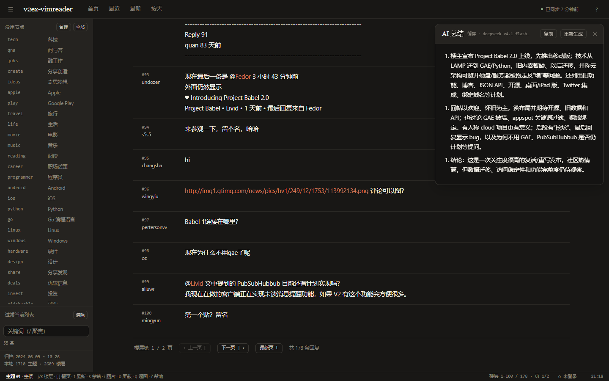

# v2ex-vimreader

> 一个安静、键盘优先的 V2EX 阅读器。只读：浏览首页、节点和帖子楼层，不发帖、不回帖。

[](https://github.com/hazukihira/v2ex-vimreader/actions/workflows/ci.yml)
[](https://github.com/hazukihira/v2ex-vimreader/releases)
[](LICENSE)


单文件 Go 服务 + 内嵌 SQLite + 原生前端，没有 Node 运行时、没有前端框架、没有 CDN 依赖。


## 特点

- **Vim 键位优先**：`j/k`、`gg/G`、`Ctrl-d/u/f/b`、`[ ]` 翻页、`/` 过滤、`:` 命令面板、数字前缀（如 `5j`）。选中项接近视口中线时页面会提前跟随滚动，长楼层先滚完当前楼层内容再切换；当前焦点用左侧短横线指示。
- **紧凑楼层视图**：楼层号、作者、时间放在左侧窄栏，正文占满剩余宽度；时间仅悬停显示，键盘光标是一条会平滑移动的短竖线 + 高亮楼层号，不整行高亮；楼主回复只保留 OP 徽标。
- **AI 总结**：配置任意 OpenAI Chat Completions 兼容接口，支持自定义 Header、流式输出、缓存；总结显示在右侧固定面板，不打断阅读位置。
- **增量同步**：站点 Atom feed + 节点 JSON feed，ETag 条件请求，主题 ID 去重，只补新内容；不会反复全量抓取。
- **按天浏览**：基于本地增量归档，按创建日期分页；归档覆盖范围会显示在界面上。
- **图片与视频**：图片懒加载、灯箱、一键打开原图；YouTube/Bilibili 默认占位，点击后才加载。
- **屏蔽**：屏蔽用户或帖子，本地 SQLite 存储，列表和楼层都生效。
- **可选登录**：粘贴自己的 V2EX Cookie（或从本机 Chrome 导入）查看受限节点；Cookie 只存本机，可随时退出清除。
- **节点管理**：侧栏常用节点可直接搜索、多选、批量增删，保存到本地数据库；打开管理器时已选节点置顶。
- **本地优先**：无账号也能用；不发送遥测，不上传浏览数据；数据库就是一个 SQLite 文件。
- **宽屏 / 收束阅读**：`w` 或 `:wide` 让楼层内容在居中窄栏和铺满横向空间之间切换，偏好本地记忆。

## 快速开始

### 下载预编译版本

到 [Releases](https://github.com/hazukihira/v2ex-vimreader/releases) 下载对应平台的文件：

| 平台 | 文件 |
| --- | --- |
| Windows x64 | `v2ex-vimreader-windows-amd64.exe` |
| Linux x64 / arm64 | `v2ex-vimreader-linux-amd64`、`v2ex-vimreader-linux-arm64` |
| macOS Intel / Apple Silicon | `v2ex-vimreader-darwin-amd64`、`v2ex-vimreader-darwin-arm64` |

运行后打开 <http://127.0.0.1:7788>。首次启动会在系统用户数据目录创建 SQLite 数据库。

```bash
# Linux / macOS
chmod +x v2ex-vimreader-linux-amd64
./v2ex-vimreader-linux-amd64

# Windows（PowerShell）
.\v2ex-vimreader-windows-amd64.exe
```

### 从源码构建

需要 Go 1.27 或更新版本：

```bash
git clone https://github.com/hazukihira/v2ex-vimreader.git
cd v2ex-vimreader
go build -trimpath -ldflags "-s -w" -o v2ex-vimreader .
./v2ex-vimreader
```

Windows 可运行 `scripts\build.ps1`，Linux/macOS 用 `scripts/build.sh`。

## 配置

把 `config.example.toml` 复制为 `config.toml`（该文件已在 `.gitignore` 中，可放 Cookie / API Key）：

```toml
listen = "127.0.0.1:7788"
data_dir = ""            # 留空使用系统用户数据目录，也可以写 "data"
log_level = "info"

[fetch]
user_agent = "v2ex-vimreader/0.1 (+https://github.com/hazukihira/v2ex-vimreader)"
requests_per_second = 1.0
burst = 2

[sync]
enabled = true
followed_nodes = ["tech", "qna", "jobs", "create", "ideas", "apple", "play", "life", "openai"]

[login]
# 可选：v2ex.com 的 Cookie，用于查看受限节点
cookie = ""

[ai]
enabled = false
base_url = "https://api.deepseek.com/v1"
model = "deepseek-chat"
api_key_env = "VIMREADER_AI_KEY"

[ai.headers]
# 中转站 / 自定义服务需要的 Header 可以写在这里
# X-Title = "v2ex-vimreader"
```

AI Key 建议用环境变量提供：

```bash
export VIMREADER_AI_KEY=sk-...        # Windows: $env:VIMREADER_AI_KEY="sk-..."
```

OpenCode Go（OpenAI 兼容端点，需要 `x-opencode-session` / `x-opencode-client` 头）示例：

```toml
[ai]
enabled = true
base_url = "https://opencode.ai/inference/go/v1"
model = "deepseek-v4.1-flash"
api_key_env = "VIMREADER_AI_KEY"

[ai.headers]
User-Agent = "v2ex-vimreader/0.1"
x-opencode-session = "v2ex-vimreader"
x-opencode-client = "v2ex-vimreader"
```

所有配置都有默认值，没有 `config.toml` 也能直接运行。

## 快捷键

| 按键 | 作用 |
| --- | --- |
| `j` / `k` | 下 / 上（接近视口中线时页面提前跟随；长楼层先滚动内容再切换） |
| `gg` / `G` | 顶部 / 底部 |
| `Ctrl-d` / `Ctrl-u` | 半屏下 / 上（主楼也生效） |
| `Ctrl-f` / `Ctrl-b` | 整屏下 / 上 |
| `Enter` / `l` / `o` | 打开主题、链接或图片 |
| `h` / `q` / `Esc` | 返回 / 关闭浮层 |
| `H` / `Ctrl-L` | 历史后退 / 前进 |
| `[` / `]` | 上一页 / 下一页（列表或楼层） |
| `t` | 跳到最新楼层页 |
| `r` / `R` | 刷新 / 强制刷新 |
| `/` + `n` / `N` | 列表过滤 / 下一个、上一个匹配 |
| `y` | 复制当前帖子链接 |
| `b` | 屏蔽菜单 |
| `x` / `u` | 屏蔽当前帖子 / 作者 |
| `m` | 切换已读标记 |
| `s` | AI 总结（帖子视图，右侧悬浮面板） |
| `w` | 宽屏 / 收束楼层内容 |
| `i` | 打开当前楼层第一张图片 |
| `g l` | 登录面板（粘贴 Cookie / 从 Chrome 导入） |
| `:` | 命令面板（`:node`、`:day`、`:nodes`、`:login`、`:theme`、`:wide` 等） |
| `?` | 帮助 |

数字前缀可用，如 `5j` 移动 5 行、`3]` 翻 3 页。

## 登录受限节点（可选）

未登录时，受限节点（`nsfw`、`chamber` 等 8 个）显示需要登录的提示，后台也不会抓取其公开 feed。

想用自己账号浏览时，按 `g l` 打开登录面板：

1. 从浏览器复制 v2ex.com 的 Cookie 粘贴到面板；或
2. 点击「从 Chrome 导入」，直接读取本机 Chrome 的登录态（Chrome 需开启远程调试，首次连接会弹出 Allow）。

Cookie 只保存到本机 SQLite，不会通过 API 返回或上传到其它地方；登录状态失效时状态栏会提示。

## AI 总结

在帖子视图按 `s` 或点「AI 总结」：右侧固定面板展示，不改变当前阅读位置。支持流式输出、复制、重新生成、错误重试；结果本地缓存 24 小时。



接口按 OpenAI Chat Completions 格式调用，兼容 DeepSeek、OpenAI、OpenCode Go、各类中转站；自定义 Header 通过 `[ai.headers]` 配置。

## 增量同步与按天浏览

V2EX 没有公开的“按创建时间翻页”的全站接口，所以：

- 后台轮询站点 `index.xml` / `read.xml` 与关注节点的 `feed/<node>.json`（最多 50 条），使用 `ETag` 条件请求，304 几乎零成本；
- 主题按 ID 去重，楼层按页补抓（100 层/页），只补新内容；
- “按天”视图查询本地 SQLite 归档，打开很快；未运行过/未覆盖的日期会显示归档缺口提示。

## 部署

### Linux systemd

仓库带了一个示例 unit（[deploy/v2ex-vimreader.service](deploy/v2ex-vimreader.service)）：

```bash
sudo useradd --system --home /var/lib/v2ex-vimreader v2ex-vimreader
sudo install -m 0755 v2ex-vimreader-linux-amd64 /usr/local/bin/v2ex-vimreader
sudo mkdir -p /etc/v2ex-vimreader /var/lib/v2ex-vimreader
sudo cp config.example.toml /etc/v2ex-vimreader/config.toml
sudo cp deploy/v2ex-vimreader.service /etc/systemd/system/
sudo systemctl enable --now v2ex-vimreader
```

默认只监听 `127.0.0.1:7788`，个人使用建议保持本机；如需公网访问请自行加反向代理和访问控制。

### Windows / macOS

直接运行可执行文件即可，数据默认在：

| 平台 | 数据目录 |
| --- | --- |
| Windows | `%LOCALAPPDATA%\v2ex-vimreader` |
| macOS | `~/Library/Application Support/v2ex-vimreader` |
| Linux | `~/.local/share/v2ex-vimreader` |

## 数据与隐私

- 所有数据保存在本机 SQLite（`v2ex-vimreader.db`），不发送遥测；
- Cookie 和 AI Key 只存在本机配置文件/SQLite，均已在 `.gitignore` 中；
- 默认请求频率 1 req/s，使用可识别 User-Agent，支持 ETag 缓存；
- 项目不绕过登录墙：受限节点要么匿名读公开页面，要么由用户主动提供自己的 Cookie。

## 开发

```bash
go test ./...
go run . -no-open -debug -web-dir web   # 开发模式：直接读 web/，不缓存静态资源
```

纯前端 mock（不需要后端）：

```bash
node scripts/serve-web.mjs
# 打开 http://127.0.0.1:7801/?mock=1
```

接口说明见 [docs/API.md](docs/API.md)，前端规格见 [docs/UI-SPEC.md](docs/UI-SPEC.md)，更多调研记录见 [docs/RESEARCH.md](docs/RESEARCH.md)。

反馈与贡献：直接开 issue / PR。解析器依赖页面结构，页面改版时可能失效；遇到问题请附上主题/节点链接和 `-debug` 日志。

## 免责声明

本项目是非官方第三方阅读器，与 V2EX 官方无关。抓取仅用于个人阅读，请遵守 V2EX 的服务条款与 robots 约定，不要用于商业转载或大规模采集。帖子内容版权归原作者所有。

## License

MIT。
