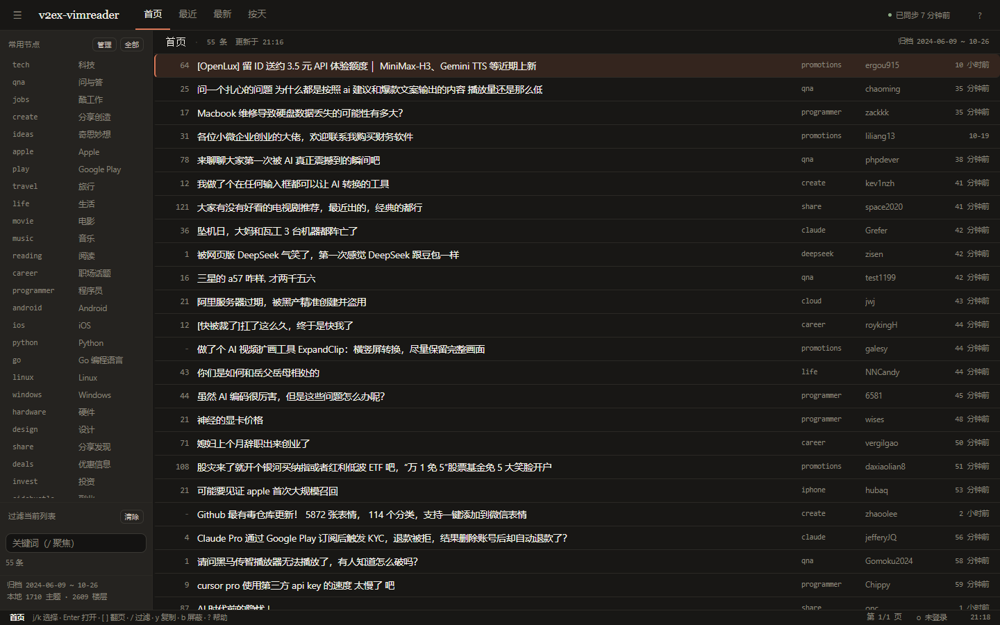
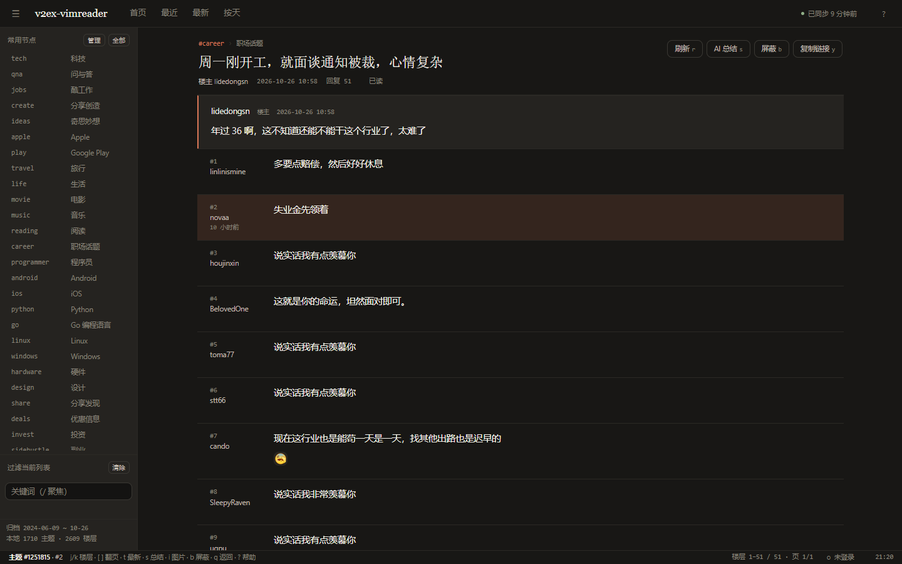
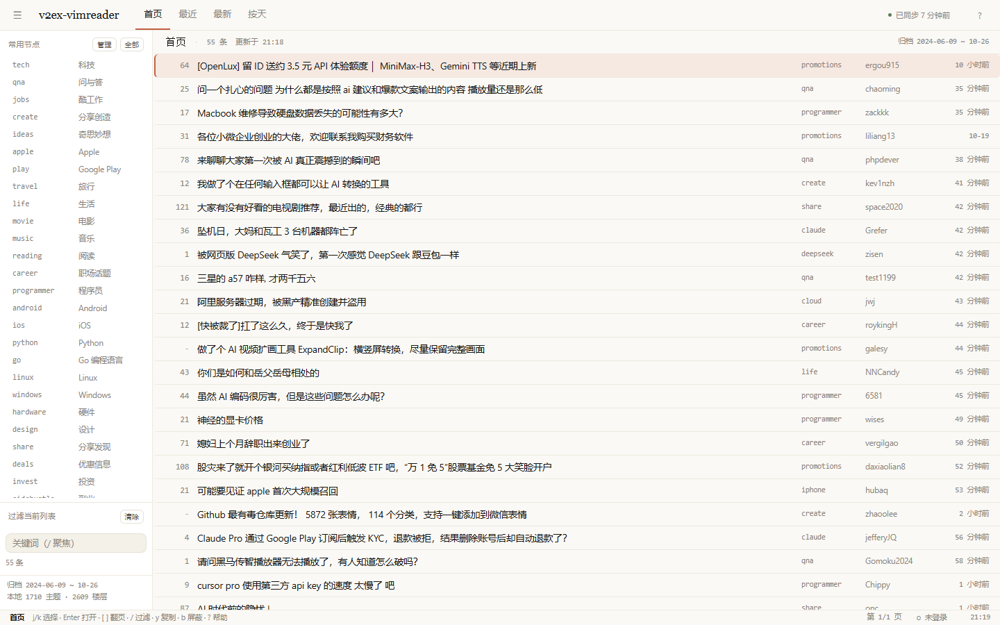

# v2ex-vimreader

> 安静、键盘优先的 V2EX 阅读器。只读：浏览首页、节点和帖子楼层，不发帖、不回帖。

[](https://github.com/hazukihira/v2ex-vimreader/actions/workflows/ci.yml)
[](https://github.com/hazukihira/v2ex-vimreader/releases)
[](LICENSE)


单文件 Go 服务 + SQLite + 原生前端，无 Node、无前端框架、无 CDN 依赖。







## 特点

- **Vim 操作**：`j/k`、`gg/G`、`Ctrl-d/u/f/b`、`[ ]`、`/`、`:` 命令面板、数字前缀。
- **紧凑楼层**：左侧窄栏放楼层号/作者/时间，正文铺满；焦点用单条光标标记，不整行高亮。
- **AI 总结**：兼容 OpenAI Chat Completions 接口，支持自定义 Header、流式输出、缓存，右侧悬浮面板。
- **增量同步**：站点 Atom feed + 节点 JSON feed，ETag 条件请求，按主题 ID 去重。
- **按天浏览**：查询本地 SQLite 归档，显示覆盖范围。
- **图片与视频**：懒加载、灯箱、原图；Bilibili/YouTube 点击后才加载。
- **预览、待读与收藏**：列表里 `p` 打开右侧预览，`a` 加入待读，`f` 收藏，`Q`/`F` 管理队列和收藏。
- **只读扩展**：屏蔽用户/帖子、多选管理常用节点、可选 Cookie 登录、宽屏/收束阅读。
- **本地优先**：无账号可用，数据保存在本机 SQLite。

## 快速开始

### 下载预编译版本

从 [Releases](https://github.com/hazukihira/v2ex-vimreader/releases) 下载：

| 平台 | 文件 |
| --- | --- |
| Windows x64 | `v2ex-vimreader-windows-amd64.exe` |
| Linux x64 / arm64 | `v2ex-vimreader-linux-amd64`、`v2ex-vimreader-linux-arm64` |
| macOS Intel / Apple Silicon | `v2ex-vimreader-darwin-amd64`、`v2ex-vimreader-darwin-arm64` |

运行后打开 <http://127.0.0.1:7788>。

### 从源码构建

需要 Go 1.27 或更新版本：

```bash
git clone https://github.com/hazukihira/v2ex-vimreader.git
cd v2ex-vimreader
go build -trimpath -ldflags "-s -w" -o v2ex-vimreader .
./v2ex-vimreader
```

Windows 可运行 `scripts\build.ps1`，Linux/macOS 用 `scripts/build.sh`。

## 配置

把 `config.example.toml` 复制为 `config.toml`。所有配置都有默认值，没有该文件也能运行。

```toml
listen = "127.0.0.1:7788"
data_dir = ""            # 留空用系统数据目录，也可以写 "data"
log_level = "info"

[fetch]
user_agent = "v2ex-vimreader/0.1 (+https://github.com/hazukihira/v2ex-vimreader)"
requests_per_second = 1.0
burst = 2

[sync]
enabled = true
followed_nodes = ["tech", "qna", "jobs", "create", "ideas", "apple", "play", "life", "openai"]

[login]
cookie = ""              # 可选：用于查看受限节点

[ai]
enabled = false
base_url = "https://api.deepseek.com/v1"
model = "deepseek-chat"
api_key_env = "VIMREADER_AI_KEY"

[ai.headers]
# 自定义 Header 写在这里，例如 X-Title = "v2ex-vimreader"
```

AI Key 建议放在环境变量 `VIMREADER_AI_KEY`。OpenCode Go 等兼容服务填写 `base_url` 和 `[ai.headers]` 即可。

## 快捷键

| 按键 | 作用 |
| --- | --- |
| `j` / `k` | 下 / 上（接近视口中线时页面跟随；长楼层先滚内容） |
| `gg` / `G` | 顶部 / 底部 |
| `Ctrl-d` / `Ctrl-u` | 半屏下 / 上 |
| `Ctrl-f` / `Ctrl-b` | 整屏下 / 上 |
| `Enter` / `Space` / `l` / `o` | 打开主题、链接或图片 |
| `h` / `q` / `Esc` | 返回 / 关闭浮层 |
| `H` / `Ctrl-L` | 历史后退 / 前进 |
| `[` / `]` | 上一页 / 下一页 |
| `t` | 跳到最新楼层页 |
| `r` / `R` | 刷新 / 强制刷新 |
| `/` + `n` / `N` | 过滤 / 下一个、上一个匹配 |
| `y` | 复制当前帖子链接 |
| `b` | 屏蔽菜单 |
| `x` / `u` | 屏蔽当前帖子 / 作者 |
| `m` | 切换已读标记 |
| `p` | 预览当前主题（列表内） |
| `a` | 加入 / 移出待读 |
| `Q` | 打开待读队列 |
| `f` | 收藏 / 取消收藏当前主题 |
| `F` | 打开收藏列表 |
| `s` | AI 总结 |
| `w` | 宽屏 / 收束楼层内容 |
| `i` | 打开当前楼层第一张图片 |
| `g l` | 登录面板 |
| `:` | 命令面板（`:node`、`:day`、`:nodes`、`:login`、`:theme`、`:wide`、`:preview`、`:queue`、`:favorite`、`:favorites`） |
| `?` | 帮助 |

数字前缀可用，如 `5j`、`3]`。

## 登录（可选）

未登录时受限节点（`nsfw`、`chamber` 等 8 个）只显示登录提示。按 `g l` 粘贴 v2ex.com Cookie，或从本机 Chrome 导入。

Cookie 保存在 `data/v2ex-vimreader.db`，重启程序后仍然有效；只有服务端 Cookie 过期或主动退出时才需要重新登录。

## AI 总结

帖子视图按 `s` 打开右侧面板，支持流式输出、复制、重新生成和缓存。接口按 OpenAI Chat Completions 格式调用，自定义 Header 通过 `[ai.headers]` 配置。

## 增量同步与按天浏览

V2EX 没有全站按创建时间翻页的公开接口，所以后台轮询站点 `index.xml` / `read.xml` 与节点 `feed/<node>.json`，用 ETag 条件请求，只补新内容。按天视图查询本地归档，未覆盖的日期会提示。

当天的主题会在后台增量预取正文和第一页回复，只处理还没抓过的条目，已经缓存的不会重复请求。正文和回复作为缓存保留最近 3 个自然日；主题标题、作者、节点等归档元数据不设过期，按天/最新视图会一直累积。节点目录和 Feed 状态保留 30 天，AI 总结保留 24 小时，前端已读/位置/过滤词保留 90 天。每天清理一次，打开旧帖时再按需抓取。收藏和待读是用户数据，不设上限，也不参与缓存过期。

## 部署

### Linux systemd

仓库带示例 unit：[deploy/v2ex-vimreader.service](deploy/v2ex-vimreader.service)。

```bash
sudo useradd --system --home /var/lib/v2ex-vimreader v2ex-vimreader
sudo install -m 0755 v2ex-vimreader-linux-amd64 /usr/local/bin/v2ex-vimreader
sudo mkdir -p /etc/v2ex-vimreader /var/lib/v2ex-vimreader
sudo cp config.example.toml /etc/v2ex-vimreader/config.toml
sudo cp deploy/v2ex-vimreader.service /etc/systemd/system/
sudo systemctl enable --now v2ex-vimreader
```

### Windows / macOS

直接运行可执行文件即可。数据默认在：

| 平台 | 数据目录 |
| --- | --- |
| Windows | `%LOCALAPPDATA%\v2ex-vimreader` |
| macOS | `~/Library/Application Support/v2ex-vimreader` |
| Linux | `~/.local/share/v2ex-vimreader` |

## 数据与隐私

- 数据保存在本机 SQLite（`v2ex-vimreader.db`）。
- Cookie 和 AI Key 只存在本机配置文件或 SQLite。
- 默认请求频率 1 req/s，使用可识别 User-Agent，支持 ETag 缓存。
- 不绕过登录墙：受限节点要么匿名读公开页面，要么由用户提供自己的 Cookie。

## 开发

```bash
go test ./...
go run . -no-open -debug -web-dir web
```

纯前端 mock：`node scripts/serve-web.mjs`，打开 <http://127.0.0.1:7801/?mock=1>。

接口见 [docs/API.md](docs/API.md)，架构与核心逻辑见 [docs/ARCHITECTURE.md](docs/ARCHITECTURE.md)，前端规格见 [docs/UI-SPEC.md](docs/UI-SPEC.md)。

## 免责声明

非官方第三方阅读器，与 V2EX 官方无关。抓取仅用于个人阅读，请遵守 V2EX 服务条款与 robots 约定；帖子版权归原作者所有。

## License

MIT。
